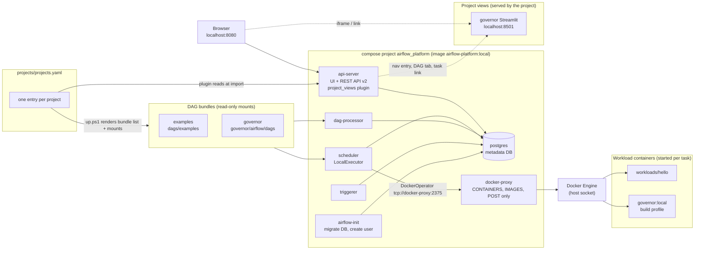
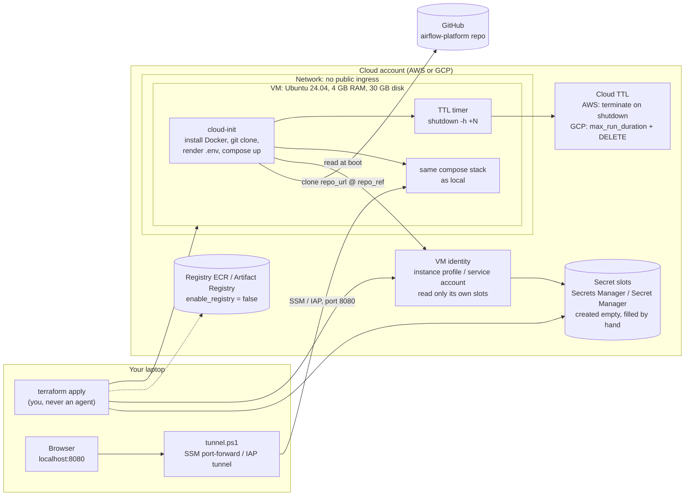

# Architecture

Two pictures: the local target and a cloud target. Both run **the same compose stack**
([ADR 0002](adr/0002-self-hosted-vm-compose.md)). Words are defined in [CONTEXT.md](../CONTEXT.md).

## Local target

Airflow never imports project code. It reads DAG files from read-only bundle mounts and starts workload
containers through a socket proxy that allows only the Docker API calls `DockerOperator` needs
([ADR 0001](adr/0001-thin-orchestrator.md)). A project's UI runs outside Airflow and shows up inside it as a
nav entry, a DAG tab and a task link ([ADR 0003](adr/0003-project-views-as-external-views.md)).

What to notice:

- The raw Docker socket is mounted **only** into `docker-proxy`, never into an Airflow container.
- Workloads are siblings of Airflow on the same Docker Engine, not children inside it.
- `projects.yaml` is the only place a project is named. `up.ps1` turns it into `stack/.env.generated` (the
  `LocalDagBundle` list) and `stack/compose.projects.yaml` (the mounts). Both files are generated and git-ignored.

## Cloud target (AWS or GCP)

Terraform creates one VM with no public ports. cloud-init installs Docker, clones this repo, reads the secret
slots with the VM's own identity, writes `stack/.env` and starts the same compose stack. You reach the UI through
a tunnel. The TTL deletes a forgotten VM. Steps are in the [runbook](runbook.md).

What to notice:

- No secret value goes through Terraform, its state, an image or a file in git. Terraform only creates the empty
  slots and the permission to read them.
- The only way in is the cloud's own tunnel (SSM or IAP), which checks your cloud login first.
- The registry is drawn dashed because it is off by default: the VM builds images from git.
